### Hi, I'm MayBee

Systems engineer focused on **security**, **infrastructure** and **distributed system design**.
I build event-driven services that stay correct under failure, harden what they run on, and automate everything I have to do twice.

- Interested in offensive security and CTFs, Linux internals, and reliable messaging
- Member of [H4ckwars](https://github.com/H4ckwars) and [Chimera Software Solutions](https://github.com/ChimeraSoftwareSolutions)

 

#### Focus areas

| | |
| :-- | :-- |
| **Security** | Penetration testing, hardening, least privilege, secret and image scanning |
| **Infrastructure** | Linux, systemd, containers, networking, observability |
| **System design** | Event-driven architecture, message queues, outbox pattern, idempotent handlers, ADRs |
| **Automation** | CI/CD pipelines, tooling and scripts for repeatable operations |

#### Tools & technologies

**Languages** · Go · Rust · Python · TypeScript · Bash · SQL  
**Backend** · chi · Node.js · Next.js · FastAPI · Django · Prisma · PostgreSQL · MySQL · NATS  
**Infrastructure** · Linux · Docker · VMware · Cisco · Prometheus · Grafana · GitHub Actions  
**Security** · Burp Suite · Metasploit · Wireshark · Trivy · Gitleaks · Kali Linux

 

  

Find me on <a href="https://tryhackme.com/p/maybee.sh">TryHackMe</a>.
